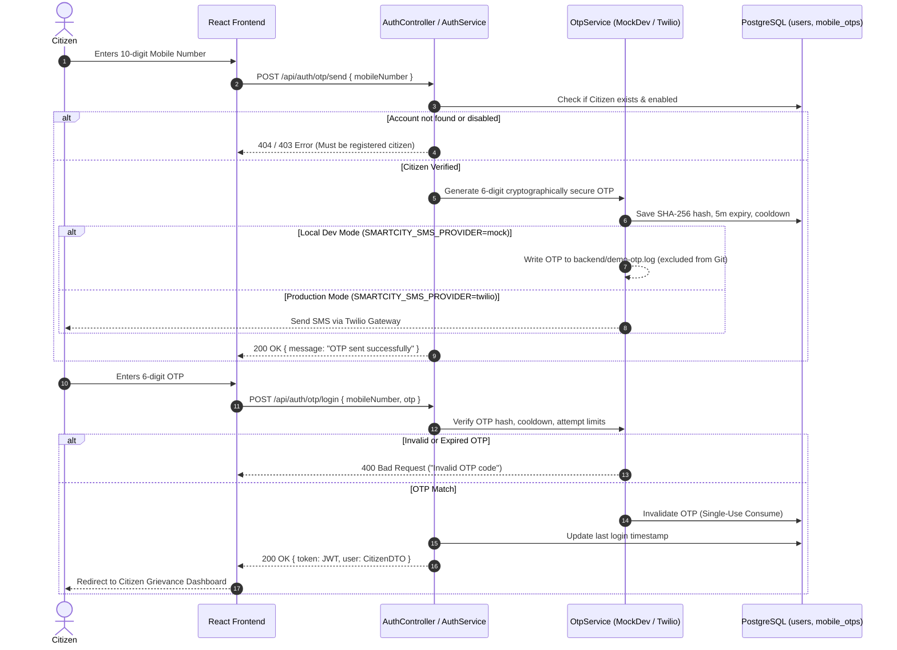
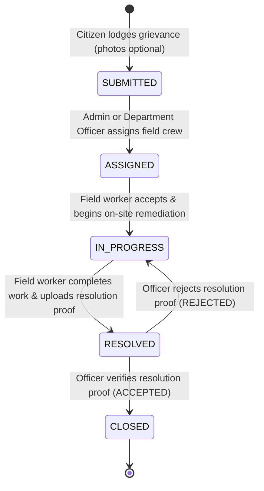
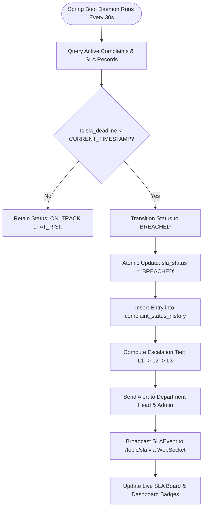

# CivicPulse Smart City Command Centre — System Workflows

## 1. Citizen Mobile OTP Login & Registration Workflow

CivicPulse implements a streamlined, credential-safe mobile number + OTP authentication flow tailored for citizens, alongside traditional username/password authentication for administrative staff.

---

## 2. Complete Grievance Redressal Lifecycle

Every citizen grievance progresses through a transparent, audited 5-stage lifecycle:

### Stage Details

#### 1. Intake (`SUBMITTED`)
- Strictly restricted to `CITIZEN` role.
- Citizen selects category (e.g. `ROADS_AND_TRAFFIC`, `WATER_SUPPLY`, `ELECTRICITY`, `SOLID_WASTE`).
- Attaches photographic evidence (stored securely in `backend/uploads/complaints/`).
- System calculates initial SLA window based on category priority matrix:
  - `CRITICAL`: 120 minutes (2 hours).
  - `HIGH`: 240 minutes (4 hours).
  - `MEDIUM`: 1440 minutes (24 hours).
  - `LOW`: 2880 minutes (48 hours).
- Automatic generation of official Digital Acknowledgement Receipt (`CP-2026-XXXXXX`) stored in `complaint_receipts`.
- Audit entry created in `complaint_status_history`.

#### 2. Triage & Assignment (`ASSIGNED`)
- Department Officer or Command Administrator reviews incoming queue.
- System surfaces eligible field workers. If a department lacks dedicated crews, a municipal fallback surfaces available city workers.
- Assigning a worker updates `assigned_to_user_id`, sets status to `ASSIGNED`, and publishes a real-time notification to the worker's queue.

#### 3. Field Execution (`IN_PROGRESS`)
- Field Worker views task on mobile dashboard.
- Submits real-time progress notes and interim photo evidence.
- Status updates to `IN_PROGRESS`.

#### 4. Work Completion (`RESOLVED`)
- Field Worker submits final resolution notes and photographic proof of the redressed defect.
- Status transitions to `RESOLVED` with `resolved_at = CURRENT_TIMESTAMP`.
- Complaint is placed in the Department Officer's **Awaiting Verification** queue.

#### 5. Verification & Closure (`CLOSED`)
- Department Officer reviews the before-and-after photo evidence.
- **Decision: ACCEPTED**:
  - Complaint transitions to `CLOSED` with `closed_at = CURRENT_TIMESTAMP`.
  - Officer marks verification status as `GENUINE`.
  - Increments citizen's `genuine_complaint_count`.
  - When genuine reports reach threshold ($\ge 3$), citizen is awarded the **Verified Citizen** badge (`verified_citizen = TRUE`).
- **Decision: REJECTED**:
  - Complaint transitions back to `IN_PROGRESS` with rejection notes.

---

## 3. SLA Deadline Monitoring & Automated Escalation Engine

### Escalation Tiers
1. **Level 1 (Supervisor)**: Triggered immediately upon deadline breach. Alerts nodal department officer.
2. **Level 2 (Department Head)**: Triggered if overdue $> 2$ hours. Notifies municipal zonal director.
3. **Level 3 (City Command Director)**: Triggered if overdue $> 6$ hours or priority is `CRITICAL`. Highlights on Command Centre video wall.

---

## 4. CP-GRAMS Government Sandbox Integration

For demonstration of inter-governmental interoperability, CivicPulse includes an external sync module:
- Simulates forwarding municipal grievances to the national CP-GRAMS portal.
- Generates external registration tokens (`CPGRAMS-ND-2026-XXXXX`).
- Tracks external acknowledgment status and sync timestamps in `external_grievances`.
- Allows citizen and administrative inspection from the complaint details modal.
